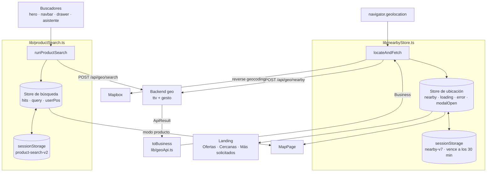

# Comprá Fácil — Mapa de tiendas

Directorio web de **tiendas, servicios y emprendimientos** cercanos a la ubicación del usuario. Tiene dos pantallas:

| Ruta | Pantalla | Qué hace |
| --- | --- | --- |
| `/` | Landing | Hero con buscador de productos, ofertas de la zona, catálogo virtual, más solicitados, tiendas cercanas. |
| `/mapa` | Mapa virtual | Mapa oscuro con pines, filtros por tipo y rubro, listado, ficha del comercio y sus ofertas, y búsqueda de productos. |

Las tiendas y sus ofertas salen de un backend externo que unifica dos plataformas: **Tu Tienda Virtual** (`ttv`) y **Gesto** (`gesto`). El mapa muestra únicamente lo que devuelve ese backend para la ubicación real del usuario: no hay ciudad ni comercios por defecto.

## Stack

- React 19 + TypeScript + Vite 8
- Tailwind CSS 4 (tokens de diseño como variables CSS en [src/index.css](src/index.css))
- React Router 7
- Mapbox GL + react-map-gl (mapa y reverse-geocoding)
- Framer Motion y GSAP (animaciones), three.js / react-three-fiber (ciudad 3D del hero)
- Deploy en Vercel

## Puesta en marcha

```bash
npm install
npm run dev      # servidor de desarrollo
npm run build    # tsc -b && vite build
npm run lint     # eslint
npm run preview  # sirve el build
```

Hace falta un archivo `.env.local` en la raíz (no se sube a git):

```
VITE_MAPBOX_TOKEN=tu_token_de_mapbox
```

Sin token el mapa no carga y el nombre de la ciudad se deduce de los comercios cercanos en lugar de Mapbox.

La geolocalización del navegador solo funciona en `https` o en `localhost`. Para probar desde un celular contra el servidor de desarrollo (`http://192.168.x.x:5173`) hace falta un túnel https; por IP local el navegador la bloquea.

## Fuentes de datos

| Fuente | Endpoint | Para qué | Código |
| --- | --- | --- | --- |
| Backend geo | `POST /api/geo/nearby` | Sucursales cercanas con sus ofertas | [src/lib/geoApi.ts](src/lib/geoApi.ts) |
| Backend geo | `POST /api/geo/search` | Productos cerca de un punto | [src/lib/productSearch.ts](src/lib/productSearch.ts) |
| Mapbox Geocoding | `GET api.mapbox.com/geocoding/v5/...` | Nombre de la ciudad a partir de lat/lng | [src/lib/mapbox.ts](src/lib/mapbox.ts) |
| Navegador | `navigator.geolocation` | Posición del usuario | [src/lib/geoApi.ts](src/lib/geoApi.ts) (`getPosition`) |
| Datos locales | — | Listas de rubros y tarjetas de muestra de "Más solicitados" (solo landing) | [src/data/](src/data/) |

### El proxy de `/api/geo`

El backend vive en `https://geo-e-commerce.vercel.app`, solo acepta `POST` con JSON y **no envía cabeceras CORS**. Por eso el front nunca lo llama directo: pide a su propio origen (`/api/geo/...`) y la petición se reenvía.

- En desarrollo: proxy de Vite en [vite.config.ts](vite.config.ts).
- En producción: rewrite en [vercel.json](vercel.json) (que además manda el resto de las rutas a `index.html` para el router).

### Contratos

**`POST /api/geo/nearby`** — body `{ latitude, longitude, radius }` (radio en metros, por defecto `5000`). Devuelve `{ results: ApiResult[] }`, una entrada por sucursal, con `source`, `name`, `storeName`, `address`, `location.coordinates` (`[lng, lat]`), `distance` en metros, `hours`, `profile` y `offers`.

**`POST /api/geo/search`** — body `{ latitude, longitude, radius, q, limit?, perStore? }` (`q` de al menos 2 caracteres). Devuelve `{ query, matchMode, total, products }`, con **una fila por producto y por local** que lo tiene. Ojo: `radius` no recorta resultados, solo marca `withinRadius`; el recorte se hace en el cliente.

## Flujo de información



### 1. Ubicación y comercios cercanos

Todo arranca en [src/lib/nearbyStore.ts](src/lib/nearbyStore.ts), que es la única fuente de verdad de la ubicación.

1. `locateAndFetch()` pide la posición al navegador y, en paralelo, llama a `fetchNearby` (backend) y a `reverseGeocode` (Mapbox).
2. Cada `ApiResult` se convierte en un `Business` con `toBusiness` (ver [Normalización](#normalización-apiresult--business)).
3. El resultado `{ pos, businesses, city, at }` se guarda en el store global y en `sessionStorage` (`nearby-v7`), así la landing y el mapa lo comparten y sobrevive a una recarga.

La ubicación guardada **vence a los 30 minutos** (`CACHE_TTL`). En mobile las pestañas quedan abiertas durante días y iOS no permite revalidar en silencio, así que una ubicación vieja se descarta y se vuelve a pedir en lugar de mostrar una zona donde el usuario ya no está. La búsqueda de productos guardada usa la misma vigencia.

El store es un módulo con `useSyncExternalStore` (sin Redux ni Context). Los componentes se suscriben con `useLocationStore()`.

**Cuándo se pide la ubicación.** Nunca se fuerza el prompt del navegador al cargar:

- `autoLocateIfGranted()` geolocaliza en silencio **solo** si el permiso ya estaba concedido.
- Si no, se espera un gesto del usuario: la barra sticky, el `LocationGate` de cada sección o el modal de permisos (`openLocationModal`). Esto es lo que Safari mobile exige para abrir el prompt de forma confiable.
- `openLocationModal(callback)` acepta una acción pendiente que corre apenas se obtiene la ubicación (por ejemplo, una búsqueda iniciada desde el hero).
- `locateShared()` deduplica: si ya hay una geolocalización en curso, devuelve la misma promesa.

### 2. Landing

[src/pages/LandingPage.tsx](src/pages/LandingPage.tsx) lee `nearby` y `loading` del store y los pasa a las secciones como `geo`.

| Sección | De dónde saca los datos |
| --- | --- |
| Ofertas destacadas | `offersOf(nearby.businesses)`: aplana las ofertas de las sucursales de la API |
| Catálogo virtual | Estático: los tres tipos de negocio (servicios y emprendimientos marcados como "próximamente") |
| Más solicitados | Tarjetas de muestra (`REQUESTED` en [src/data/offers.ts](src/data/offers.ts)), marcadas como "Próximamente" |
| Tiendas cercanas | `nearby.businesses` filtrado por `type === 'tienda'` |

Mientras no hay ubicación, las secciones que dependen de ella muestran `LocationGate` en vez de datos de una ciudad por defecto.

La landing navega al mapa pasando el contexto por la URL:

- `/mapa?type=tienda&id=10003` → abre el mapa filtrado y con una ficha seleccionada.
- `/mapa?q=yerba` → abre el mapa y ejecuta esa búsqueda de productos.

### 3. Mapa

[src/pages/MapPage.tsx](src/pages/MapPage.tsx) se carga con `lazy()` para que `mapbox-gl` no pese en la landing.

**El mapa no se dibuja hasta conocer la ubicación real.** No existe un centro por defecto: mientras no hay posición, la pantalla muestra `LocationGate` y abre el modal de permisos. Recién con la posición se monta `MapView`, ya centrado en ella. Esto vale igual en desktop y en mobile.

Tiene **dos modos**:

**Modo normal (comercios).** Lista = sucursales que devolvió la API para el centro de búsqueda, sin agregados. Se filtra por tipo y rubro (`MapTopBar`), y se muestra en `MapView` (pines), `ResultsPanel` (listado) y `BusinessSheet` + `OffersStrip` (ficha).

**Modo producto.** Se activa cuando el store de búsqueda tiene resultados. Los pines pasan a ser un `ProductMarker` por tienda, el mapa se encuadra sobre ellas y la ficha es `ProductResultSheet`. Se sale cerrando el banner de resultados.

El mapa maneja tres posiciones distintas, y conviene no confundirlas:

| Estado | Qué es |
| --- | --- |
| `userPos` | GPS real del usuario (marcador pulsante, botón "Mi ubicación") |
| `searchCenter` | Centro del último `POST /nearby`; se dibuja como un círculo de 5 km |
| `mapCenter` | Centro actual de la vista, se actualiza al terminar de mover el mapa |

Cuándo se vuelve a consultar el backend:

- **Entrada con caché:** se muestra al instante y se revalida en segundo plano (`refresh`).
- **Volver a la pestaña** (`visibilitychange`): se revalida para traer sucursales recién creadas. Solo pisa el listado si el usuario sigue mirando su propia zona (menos de 50 m entre `searchCenter` y el GPS).
- **"Explorar aquí":** aparece cuando `mapCenter` se aleja más del 60% del radio respecto de `searchCenter`. Repite el `POST` con el centro de la vista y reemplaza las sucursales, sin tocar `userPos`.
- **Re-detección desde la barra sticky** (reabre el modal de permisos): el mapa solo se re-centra si la nueva posición está a más de 30 m de la anterior.

### 4. Búsqueda de productos

Todos los buscadores (hero, navbar, drawer mobile y el asistente) usan la misma función: `runProductSearch(query, center?)` en [src/lib/productSearch.ts](src/lib/productSearch.ts).

1. **Ubicación:** usa `center` si se pasó (en el mapa, el punto explorado); si no, la caché de cercanos; si no, pide el GPS.
2. **Consulta** a `POST /api/geo/search` con radio de 5000 m.
3. **Filtro en el cliente:** descarta productos con `distance > 5000`, porque la API no recorta.
4. **Agrupa** las filas por local con `groupByStore` (clave `pinId`) → un `ProductHit` por tienda, con sus productos.
5. **Guarda** el resultado en el store de búsqueda y en `sessionStorage` (`product-search-v2`).

Devuelve un estado que cada buscador traduce a su propia UI:

| Estado | Significado |
| --- | --- |
| `ok` | Hay resultados; el store quedó actualizado y el mapa pasa a modo producto |
| `empty` | Consulta válida, sin coincidencias en el radio |
| `need-location` | No se pudo obtener la ubicación |
| `error` | Falló la red o la consulta tiene menos de 2 caracteres |

El **asistente de compra** (robot flotante, [src/components/assistant/ShopAssistant.tsx](src/components/assistant/ShopAssistant.tsx)) está oculto con `SHOP_ASSISTANT_ENABLED = false`. Es un buscador de productos, no un chatbot; ponerlo en `true` lo reactiva en landing y mapa.

## Normalización: `ApiResult` → `Business`

`ttv` y `gesto` devuelven formas distintas; `toBusiness` en [src/lib/geoApi.ts](src/lib/geoApi.ts) las unifica en el tipo `Business` de [src/data/types.ts](src/data/types.ts), que es lo único que consume la UI.

| Campo de `Business` | Origen |
| --- | --- |
| `id` | `10001 + índice` (`API_ID_BASE`) |
| `type` | Siempre `'tienda'` (el backend aún no devuelve servicios ni emprendimientos) |
| `category` | `profile.chainType` (llega en inglés) mapeado con `CHAIN_TYPES`; sin coincidencia → `'otros'` |
| `image` | `image` (ttv) → `profile.logo` (gesto) → foto de respaldo |
| `open` | Calculado con `isOpenApi(hours)` según la hora actual; si no hay horarios, `status` |
| `delivery` | `orderDelivery` (ttv: `ambos` / `retiro` / `delivery`) o `profile.hasDelivery` (gesto) |
| `web` | `storeUrl` o `profile.storeUrl` |
| `deals` | `offers`, cada una con sus productos y descuento |
| `lat` / `lng` | `location.coordinates`, que viene como `[lng, lat]` |
| `search` | Texto en minúsculas para filtrar (nombre, rubro, dirección, ofertas, productos) |

Para sumar un rubro nuevo hay que agregarlo en tres lugares: `CategoryKey` en [src/data/types.ts](src/data/types.ts), `CHAIN_TYPES` en [src/lib/geoApi.ts](src/lib/geoApi.ts) y las listas de categorías en [src/data/businesses.ts](src/data/businesses.ts).

El cálculo de "abierto ahora" está en [src/lib/hours.ts](src/lib/hours.ts): `isOpenApi` para el formato de la API (`"10:00-12:00,18:00-22:00"`, con `weekday` y `saturday`; domingo se considera cerrado) e `isOpen` para horarios en texto libre (hoy sin uso, quedó de los datos de ejemplo).

## Estructura

```
src/
├── main.tsx, App.tsx        Entrada y rutas ("/" y "/mapa")
├── pages/                   LandingPage y MapPage: orquestan estado y flujo
├── features/
│   ├── landing/             Secciones de la landing (Hero, Offers, Catalog, Nearby...)
│   ├── map/                 MapView, MapTopBar, ResultsPanel, fichas y controles
│   └── location/            Modal de permisos, barra sticky y LocationGate
├── components/
│   ├── ui/                  Botones, chips, inputs, iconos (sistema de diseño)
│   ├── business/            Cards, markers y fichas de comercio
│   ├── brand/               Wordmark, títulos neón, fondos
│   └── assistant/           Asistente de compra (deshabilitado)
├── lib/                     Acceso a datos y stores (ver arriba)
└── data/                    Tipos de dominio, rubros y tarjetas de muestra de la landing
```

La regla general: `lib/` habla con el exterior y guarda el estado compartido, `pages/` decide qué mostrar, y `features/` y `components/` solo renderizan lo que reciben.

## Diseño

La especificación visual (tokens, tipografías, animaciones y prototipos HTML de referencia) está en [design_handoff_compra_facil/design_handoff_compra_facil/README.md](design_handoff_compra_facil/design_handoff_compra_facil/README.md). Es solo referencia: no forma parte del build.

## Pendientes conocidos

- El backend solo devuelve tiendas. Los filtros de servicios y emprendimientos del mapa quedan vacíos hasta que el backend los envíe, y "Más solicitados" en la landing son tarjetas de muestra.
- `fetchNearby` y `searchProducts` dejan un `console.log` con la respuesta cruda, útil para depurar.
